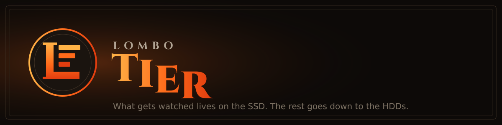

<p align="center"></p>

<p align="center">
  <a href="LICENSE"></a>
  <a href="https://github.com/Lombo-Forge/lombo-tier/actions/workflows/ci.yml"></a>
  <a href="https://github.com/Lombo-Forge/lombo-tier/actions/workflows/codeql.yml"></a>
  <a href="https://github.com/Lombo-Forge/lombo-tier/releases"></a>
  
  <a href="https://ko-fi.com/datlombardo"></a>
</p>

# LomboTier

LomboTier keeps what people watch on your SSD and moves the rest to your HDDs. It moves whole movie folders and TV season folders inside a mergerfs pool, based on what Jellyfin says was played.

## Contents

- [What `plan` shows](#what-plan-shows)
- [Install in a minute](#install-in-a-minute)
- [How it decides](#how-it-decides)
- [Commands](#commands)
- [Pinned titles, conversion sessions and `tiers.json`](#pinned-titles-conversion-sessions-and-tiersjson)
- [Settings](#settings)
- [FAQ](#faq)
- [What is not verified](#what-is-not-verified)
- [Not included](#not-included)
- [Contributing and licence](#contributing-and-licence)

## What `plan` shows

Made-up numbers and titles, real format. `plan` only shows; it never moves anything:

```
SSD free (counted for planning): 52.0 GB; target 80.0 GB
Move to HDD (2):
  movies/Old Western (1962)  18.4 GB  never watched, added 61 days ago
  tv/Quiet Show/Season 02  41.0 GB  last watched 94 days ago
Move back to SSD (1):
  tv/Space Show/Season 03  36.2 GB  next season of 3 episodes watched this week
Most watched recently: tv/Space Show/Season 02 (3 viewers, on ssd)
```

## Install in a minute

1. In Jellyfin, open Dashboard > API Keys and create a key for LomboTier.
2. Copy `.env.example` to `.env` and fill in the Jellyfin URL, the key, the path prefix and your branch folders.
3. Start it and check it:
   ```sh
   docker compose -f compose.example.yaml up -d
   docker compose -f compose.example.yaml exec lombo-tier lombo-tier doctor
   docker compose -f compose.example.yaml exec lombo-tier lombo-tier plan
   ```

It starts in dry-run mode and moves nothing. Try `doctor`, then `plan`, then a single `move` with `LOMBO_TIER_DRY_RUN=true`. Set it to `false` only after that. The full steps are in [docs/setup.md](docs/setup.md).

## How it decides

- It moves a title to the HDDs only when SSD free space is below the reserve plus the headroom. Coldest first: never watched, then least popular, then longest unwatched.
- It never moves a title that is playing, is still hard-linked to a seeding torrent, is newer than `MIN_AGE_DAYS`, or came back to the SSD within `PIN_DAYS`.
- It moves titles that are being watched back to the SSD. For a series, several episodes this week bring over the season in progress and the next one. A movie played `HOT_PLAYS` times this month comes over. Anything that `POPULAR_VIEWERS` different people watched this month comes over.
- The unit is a movie folder or one season folder, and a run moves at most `MAX_GB_PER_RUN`.
- Every copy is checked by hash before the original is removed. A move stops when someone starts watching. If a pool disk is not mounted, nothing moves.

More detail: [docs/how-it-works.md](docs/how-it-works.md).

## Commands

| Command | What it does |
|---|---|
| `lombo-tier doctor` | Checks settings, Jellyfin, the API key, that the SSD and HDD branches exist, are mounted and have space, that at least one of your library folders exists, and that Jellyfin's file paths match the prefix. Exit code 1 on a failure. |
| `lombo-tier plan [--json]` | Shows tonight's plan. Changes nothing. Does not wake a sleeping HDD beyond what the saved file list needs. |
| `lombo-tier run [--no-wait] [--loop]` | Does the plan. With `DRY_RUN=true` it only prints it. It waits up to `WAIT_QUIET_MINUTES` for nobody to be watching (`--no-wait` skips that). `--loop` repeats daily at `RUN_HOUR` in the container's `TZ`. |
| `lombo-tier move NAME [NAME...] [--dry-run]` | Moves the named titles from the SSDs to the HDDs now, with the same safety checks as a night's run, and records it in `state.json`. `NAME` is a title folder such as `Jaws (1975)` or a pool path such as `movies/Jaws (1975)`. A name that matches nothing, or several things, is an error that lists the matches and moves nothing. `--dry-run` (or `DRY_RUN=true`) only prints the plan. |
| `lombo-tier pin add NAME...`, `pin remove NAME...`, `pin list` | Edit or show the list of pinned titles (needs `LOMBO_TIER_PIN_FILE`). A pinned title is never moved off the SSD. See [docs/pinned-titles.md](docs/pinned-titles.md). |

Exit codes: 0 ok, 1 failure, 2 bad settings (or a title name that `move` or `pin` cannot find or that matches several).

## Pinned titles, conversion sessions and `tiers.json`

- **Pinned titles.** `LOMBO_TIER_PIN_FILE` is a JSON list of titles that never leave the SSD. Optionally
  `LOMBO_TIER_PIN_BRANCH` names one SSD that pinned titles are gathered onto. A pin list that cannot be read makes
  the run and `move` stand down; `doctor` shows FAIL. See [docs/pinned-titles.md](docs/pinned-titles.md).
- **Conversion sessions.** With `LOMBO_TIER_SESSION_FILE` set, nothing moves while that file says another tool (such
  as a converter) has a session open. The file's shape is a proposal for LomboShrink, which does not write it yet.
  See [docs/contracts.md](docs/contracts.md).
- **`tiers.json`.** After every run, `tiers.json` in the data folder lists where each movie and season folder is
  (`ssd` or `hdd`), its size and whether it is pinned, in a versioned shape other tools may read. See
  [docs/contracts.md](docs/contracts.md).
- **Post-move command.** `LOMBO_TIER_POST_MOVE_COMMAND` (empty = off) is run once after a run or `move` that
  really moved something, for example to ask Sonarr or Radarr to rescan. It is started without a shell, gets the moved
  unit paths as JSON in `LOMBO_TIER_MOVED_JSON`, and never runs in a dry run. If it fails, the result and the log
  line get a note such as `post-move command failed (exit 1)`; the run itself is not failed. See
  [docs/contracts.md](docs/contracts.md).
- **One at a time.** A live run or `move` takes a lock in the data folder; a second one does not start.

Security notes (what it trusts, refuses and never logs): [docs/security.md](docs/security.md).

## Settings

Everything is an environment variable with the `LOMBO_TIER_` prefix. All of them, with defaults, are in [.env.example](.env.example).

## FAQ

**Is it safe?** It is safe by default: `LOMBO_TIER_DRY_RUN=true` until you set it to false. It copies, checks the copy by hash, and only then removes the original. It still moves real files, so try it as described in [docs/setup.md](docs/setup.md) and keep backups of anything you cannot replace.

**What if a disk is missing?** Nothing moves. With `CHECK_MOUNTS=true` it checks every branch is mounted before it starts, and `doctor` tells you which one is not.

**Does it need Sonarr or Radarr?** No. It reads watch data from Jellyfin and works on folders. Paths in the pool do not change when a title moves, so those apps do not notice.

**What about torrents that are still seeding?** A title with a file that has another hard link is left where it is. When the torrent is gone, the title can move.

## What is not verified

The tests use folders in a temporary directory and a fake Jellyfin. These have **not** been checked against the real
thing, so try them on a small title with `DRY_RUN=true` first:

- A real mergerfs pool and real mounts, including the mount checks and a disk going missing mid-run.
- A real Jellyfin server: the play data, the "now playing" answers and the path prefix.
- A real conversion tool writing the session file. LomboShrink does not write it yet; the shape in
  [docs/contracts.md](docs/contracts.md) is a proposal, and only LomboTier's reading of it is tested.
- A real client reading `tiers.json` (a web-client plugin or a dashboard). Only the shape is tested.
- The run lock across two containers sharing one data folder. It is tested with two handles in one process, and it
  relies on the data folder being on a local disk (file locks on some network shares are not reliable).
- Sleeping HDDs staying asleep.

## Not included

- A web interface.
- Sonarr or Radarr integration.
- A reserve for a boot disk.

## Contributing and licence

Contribution, security and conduct rules come from the [Lombo-Forge organisation](https://github.com/Lombo-Forge/.github). Licensed under [GPL-3.0](LICENSE). Credits are in [NOTICE.md](NOTICE.md). Not affiliated with or endorsed by the Jellyfin project.
